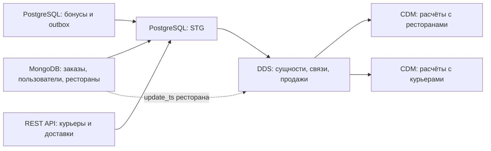

# Учебное DWH из нескольких источников

Хранилище данных для сервиса ресторанных заказов и доставки. Проект объединяет данные заказов, бонусной системы и курьерского API в PostgreSQL, связывает их в детальном слое и рассчитывает витрины взаиморасчётов с ресторанами и курьерами.

**Стек:** Python, SQL, PostgreSQL, MongoDB, REST API, Apache Airflow, psycopg, Pydantic, Docker Compose.

Проект выполнен в ходе обучения. В качестве основы были предоставлены пример загрузки одной сущности одного источника в STG и соответствующий `pg_saver.py`; механизм курсора из примера использован как учебная заготовка. Остальные загрузчики, преобразования DDS, ресторанная и курьерская витрины CDM и их DAG реализованы непосредственно мной в ходе курса.

## Поток данных



### Источники и STG

| Источник | Что загружается | Таблицы STG |
|---|---|---|
| MongoDB системы заказов | Документы `restaurants`, `users`, `orders` | `ordersystem_restaurants`, `ordersystem_users`, `ordersystem_orders` |
| PostgreSQL бонусной системы | `ranks`, `users`, события `outbox` | `bonussystem_ranks`, `bonussystem_users`, `bonussystem_events` |
| REST API доставки | Ответы методов `couriers` и `deliveries` | `deliverysystem_couriers`, `deliverysystem_deliveries` |

Документы MongoDB сохраняются как JSON в текстовом `object_value`, рядом с `object_id` и `update_ts`. Повторная запись документа обновляет снимок по `object_id`. Курьерские ответы преобразуются в отдельные поля: идентификаторы заказа, доставки и курьера, адрес, время доставки, оценка и чаевые.

Состояние загрузок хранится в `stg.srv_wf_settings`: отдельный `workflow_key` и JSON с последней обработанной отметкой времени или идентификатором.

### DDS

| Таблица DDS | Назначение |
|---|---|
| `dm_users` | Пользователи системы заказов |
| `dm_restaurants` | Рестораны, название и границы действия записи |
| `dm_products` | Товары меню, цена, ресторан и границы действия записи |
| `dm_timestamps` | Время заказа и календарные атрибуты |
| `dm_couriers`, `dm_deliveries` | Курьеры и доставки с оценками и чаевыми |
| `dm_orders` | Заказы со статусом и ссылками на пользователя, ресторан, время и доставку |
| `fct_product_sales` | Товарные позиции из `bonus_transaction`: количество, суммы и бонусы |
| `srv_wf_settings` | Состояние преобразований STG -> DDS |

Загрузчики извлекают вложенные поля JSON и сопоставляют идентификаторы источников с ключами DDS. Временные таблицы используются для подготовки продуктов, заказов, доставок и продаж. DDL содержит первичные и внешние ключи, а также проверки для части числовых полей.

Внутри `load_dds_dag` сначала загружаются пользователи, рестораны, время и курьеры; затем доставки; после них продукты и заказы; последними - продажи. Загрузка ресторанов дополнительно читает `update_ts` непосредственно из MongoDB.

### CDM

**`cdm.dm_settlement_report` - ресторан за день заказа.**

- Учитывает заказы со статусом `CLOSED`, для которых есть товарные продажи.
- Содержит число уникальных заказов, сумму продаж, списанные и начисленные бонусы.
- Комиссия сервиса: 25% суммы продаж.
- Выплата ресторану: `сумма продаж - комиссия - списанные бонусы`.
- Агрегат пересчитывается и обновляется по ключу `(restaurant_id, settlement_date)`.

**`cdm.dm_courier_ledger` - выплата курьеру за предыдущий календарный месяц.**

- Период определяется по времени заказа из `dm_timestamps`, а не по времени доставки.
- Сначала товарные продажи агрегируются до заказа, затем рассчитываются показатели курьера.
- Средняя оценка курьера за месяц определяет оплату каждого заказа: 5%, 7%, 8% или 10% суммы с минимумом 100, 150, 175 или 200 соответственно; границы рейтинга: 4.0, 4.5, 4.9.
- Итоговая выплата: `сумма оплат заказов + 95% чаевых`. Отдельно сохраняется комиссия сервиса 25%.
- Предыдущий месяц удаляется и вставляется заново в транзакции; более старые месяцы сохраняются.

## Структура

```text
.
├── docker-compose.yml
├── requirements.txt
└── src/dags/
    ├── init_dwh_dag/
    │   ├── init_schema_dag.py
    │   └── scripts/dwh_ddl.sql   # схемы STG, DDS, CDM и ограничения
    ├── examples/stg/
    │   ├── order_system_restaurants_dag/ # MongoDB -> STG
    │   ├── bonus_system_ranks_dag/       # бонусная БД -> STG
    │   ├── delivery_system_dag/          # API -> STG
    │   └── stg_settings_repository.py
    ├── dds/                    # загрузчики, сопоставление ключей, состояние
    └── cdm/                    # два SQL расчёта и DAG для них
```

Название каталога `examples` сохранено из структуры курса и само по себе не обозначает авторство всех файлов в нём.

## Среда и настройки

Архив рассчитан на подготовленную учебную среду. Он не содержит исходные БД, тестовые наборы данных, сертификат MongoDB и библиотеку `lib`, которую импортируют DAG'и (необходима для подключения к системам-источникам).

### Airflow Connections

Создать PostgreSQL-подключения с идентификаторами:

| Connection ID | Назначение |
|---|---|
| `PG_WAREHOUSE_CONNECTION` | Целевая БД; права на создание схем, таблиц, индексов и запись данных |
| `PG_ORIGIN_BONUS_SYSTEM_CONNECTION` | Чтение `ranks`, `users`, `outbox` бонусной системы |

Адрес, порт, имя БД и учётные данные задаются для собственной среды.

### Airflow Variables

| Имя | Что настроить |
|---|---|
| `MONGO_DB_CERTIFICATE_PATH` | Путь к сертификату, доступный процессам Airflow |
| `MONGO_DB_USER`, `MONGO_DB_PASSWORD` | Учётные данные MongoDB |
| `MONGO_DB_REPLICA_SET` | Имя replica set |
| `MONGO_DB_DATABASE_NAME`, `MONGO_DB_HOST` | БД и адрес своей MongoDB |
| `BASE_URL` | Базовый URL API |
| `X-NICKNAME`, `X-COHORT`, `X-API-KEY` | Значения заголовков, выданные для учебного API |

Variables читаются при построении части DAG, поэтому их необходимо создать до проверки импорта.

# При локальном запуске данные загружаться в DWH не будут, т.к. все подключения к системам-источникам приватны и были выданы в рамках курса